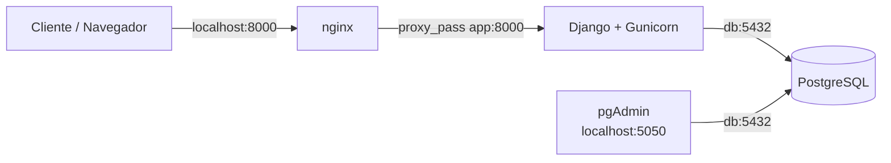

# AE4 — Aplicación Web con base de datos en contenedores

## 1. Objetivo

En esta práctica se despliega una aplicación web contenerizada formada por cuatro servicios:

- **Django + Gunicorn** como servidor de aplicaciones.
- **PostgreSQL** como base de datos.
- **pgAdmin** para administrar PostgreSQL.
- **nginx** como servidor web y proxy inverso.

Todo el despliegue se gestiona mediante **Docker Compose**.

La aplicación y el fichero inicial de base de datos parten del `material.zip` proporcionado en el Campus y se han adaptado a los requisitos de la AE4.

---

## 2. Arquitectura



El cliente accede únicamente a nginx por el puerto `8000`. nginx actúa como proxy inverso y reenvía las peticiones al servicio `app`, donde Gunicorn ejecuta la aplicación Django.

Django accede a PostgreSQL mediante la red interna de Docker Compose utilizando el nombre del servicio `db`.

pgAdmin también accede a PostgreSQL mediante `db:5432`.

---

## 3. Estructura del proyecto

```text
ae4/
├── README.md
├── comprobaciones.txt
├── compose.yml
├── db/
│   └── init.sql
├── app/
│   ├── Dockerfile
│   ├── manage.py
│   ├── requirements.txt
│   ├── config/
│   │   ├── __init__.py
│   │   ├── settings.py
│   │   ├── urls.py
│   │   └── wsgi.py
│   └── api/
│       ├── __init__.py
│       ├── urls.py
│       └── views.py
├── nginx/
│   └── default.conf
├── deploy.sh
├── .gitignore
└── .git/
```

El fichero `.env` se utiliza únicamente de forma local para las credenciales y está excluido del repositorio mediante `.gitignore`.

---

## 4. Servicios de Docker Compose

El fichero `compose.yml` define cuatro servicios.

### PostgreSQL — `db`

Se utiliza la imagen:

```text
postgres:16-alpine
```

La base de datos se llama `travelroad` y el usuario utilizado por la aplicación es `alumno`.

El fichero:

```text
db/init.sql
```

se monta dentro de `/docker-entrypoint-initdb.d/` para crear e inicializar la tabla `places` la primera vez que se crea el volumen.

Los datos de PostgreSQL se almacenan en un volumen persistente.

### pgAdmin — `pgadmin`

Se utiliza pgAdmin para administrar PostgreSQL.

Se publica en:

```text
http://localhost:5050
```

Dentro de pgAdmin se registra PostgreSQL utilizando:

```text
Host: db
Port: 5432
Database: travelroad
Username: alumno
```

La contraseña se obtiene del entorno y no se almacena en el repositorio.

### Django + Gunicorn — `app`

La imagen del servicio se construye mediante:

```text
app/Dockerfile
```

Gunicorn ejecuta la aplicación WSGI de Django mediante:

```text
config.wsgi:application
```

El servicio escucha internamente en el puerto `8000`, pero no publica directamente ese puerto al anfitrión.

El acceso se realiza mediante nginx.

### nginx — `nginx`

Se utiliza la imagen oficial:

```text
nginx:1.27-alpine
```

El puerto publicado es:

```text
8000:80
```

La configuración se encuentra en:

```text
nginx/default.conf
```

y nginx reenvía las peticiones hacia:

```text
http://app:8000
```

---

## 5. Credenciales y variables de entorno

Las credenciales no se almacenan directamente en `compose.yml`.

Se utiliza un fichero local `.env` con variables como:

```text
DB_PASSWORD=...
PGADMIN_EMAIL=...
PGADMIN_PASSWORD=...
```

El fichero `.env` está incluido en `.gitignore` y no forma parte del repositorio.

Se comprobó mediante:

```bash
git check-ignore -v .env
git ls-files .env
```

que Git ignora correctamente el fichero y que no está versionado.

---

## 6. Despliegue

Para desplegar toda la aplicación se utiliza:

```bash
./deploy.sh
```

El script realiza automáticamente:

1. Construcción de las imágenes con `docker compose build`.
2. Arranque de los servicios con `docker compose up -d`.
3. Espera hasta que `http://localhost:8000/healthz` responda correctamente.

El script termina mostrando las URLs principales:

```text
Web:     http://localhost:8000
pgAdmin: http://localhost:5050
Health:  http://localhost:8000/healthz
```

También puede realizarse manualmente:

```bash
docker compose build
docker compose up -d
docker compose ps
```

---

## 7. Comprobaciones realizadas

### Estado de los servicios

```bash
docker compose ps
```

Los cuatro servicios arrancan correctamente:

- `app`: Up y healthy.
- `db`: Up y healthy.
- `nginx`: Up.
- `pgadmin`: Up.

### Página principal

```bash
curl -i http://localhost:8000/
```

Resultado:

```text
HTTP/1.1 200 OK
```

La página también se comprobó desde el navegador mediante:

```text
http://localhost:8000
```

### Endpoint de salud

```bash
curl -i http://localhost:8000/healthz
```

Resultado:

```text
HTTP/1.1 200 OK
```

La aplicación devuelve un JSON indicando que el servicio está funcionando:

```json
{"status":"ok"}
```

### Base de datos

Se comprobó el número de registros almacenados mediante:

```bash
docker compose exec -T db psql -U alumno -d travelroad -c "SELECT count(*) FROM places;"
```

Resultado:

```text
11
```

Por tanto, `db/init.sql` ha creado y cargado correctamente los 11 lugares.

### API de lugares

```bash
curl -s http://localhost:8000/api/lugares
```

La API devuelve correctamente los 11 registros almacenados en PostgreSQL en formato JSON.

### pgAdmin

Se comprobó el servicio mediante:

```bash
curl -s http://localhost:5050/misc/ping
```

Resultado:

```text
PING
```

Además, en pgAdmin se registró correctamente el servidor PostgreSQL mediante `db:5432`.

---

## 8. Persistencia

Se comprobó la persistencia tanto de PostgreSQL como de los datos utilizados por la aplicación.

### Persistencia de la aplicación

Antes de reiniciar el servicio se mostraban:

```text
Visitas totales: 13
```

Se reinició únicamente la aplicación:

```bash
docker compose restart app
```

Tras el reinicio, el contador pasó a:

```text
Visitas totales: 14
```

El contador no volvió a cero, por lo que los datos persistieron correctamente.

### Persistencia de PostgreSQL

Se reinició el servicio:

```bash
docker compose restart db
```

Después se volvió a ejecutar:

```bash
docker compose exec -T db psql -U alumno -d travelroad -c "SELECT count(*) FROM places;"
```

El resultado continuó siendo:

```text
11
```

Por tanto, la tabla y sus datos permanecen después del reinicio del contenedor.

---

## 9. Evidencias

El fichero:

```text
comprobaciones.txt
```

contiene las salidas reales de las principales comprobaciones realizadas:

- estado de Docker Compose;
- página principal;
- `/healthz`;
- registros de PostgreSQL;
- `/api/lugares`;
- respuesta de pgAdmin;
- permisos de `deploy.sh`;
- estructura final del proyecto.

---

## 10. Repositorio Git

El proyecto utiliza un repositorio Git independiente dentro de `ae4/`.

Repositorio remoto:

```text
https://github.com/mariaizdo05/dpl-ae4
```

Antes de la entrega se comprueba que no existen credenciales ni archivos `.env` versionados.
